# VPC Foundation, Compute and Load Balancing

## Evidence 01
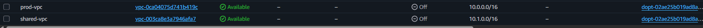

Original Caption:
Figure 1.1 (T2 & T10): Production VPC (vpc-0ca04075d741b419c, 10.0.0.0/16) and Shared Services VPC (vpc-003ca8e3a7946afa7, 10.1.0.0/16) Available in us-east-1.

## Evidence 02
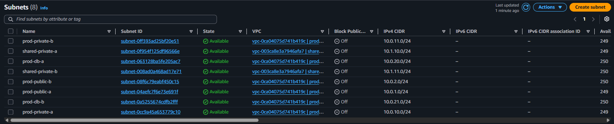

Original Caption:
Figure 1.2 (T3 & T10): All 8 Subnets — prod-public-a/b (10.0.1.0/24, 10.0.2.0/24), prod-private-a/b (10.0.10.0/24, 10.0.11.0/24), prod-db-a/b (10.0.20.0/24, 10.0.21.0/24), and shared-private-a/b (10.1.10.0/24, 10.1.11.0/24).

## Evidence 03
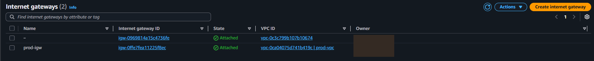

Original Caption:
Figure 1.3 (T4): Internet Gateway prod-igw (igw-0ffe7fea11225f8ec) Attached to prod-vpc.

## Evidence 04
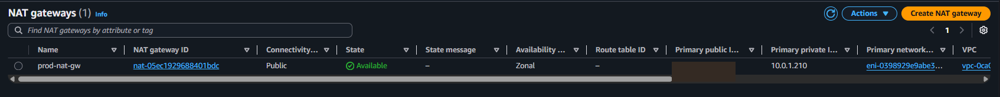

Original Caption:
Figure 1.4 (T5): NAT Gateway prod-nat-gw (nat-05ec1929688401bdc) Available in prod-public-a with Elastic IP [REDACTED_PUBLIC_IP] (Private IP 10.0.1.210).

## Evidence 05
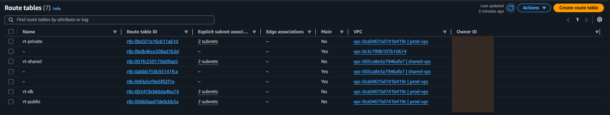

Original Caption:
Figure 1.5 (T6 & T10): Custom Route Tables — rt-public (rtb-056b0aad7de0cbb3a), rt-private (rtb-0bc021a16cb11a61d), rt-db (rtb-0b3419cb66da46a74, local only), and rt-shared (rtb-001fc230175b09ae5), each explicitly associated with 2 subnets.

## Evidence 06
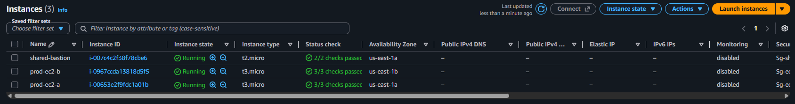

Original Caption:
Figure 1.6 (T7 & T11): All 3 EC2 Instances Running with 0 Public IPs — prod-ec2-a (i-00653e2f9fdc1a01b, 3/3 checks passed), prod-ec2-b (i-0967ccda13818d5f5, 3/3 checks passed), and shared-bastion (i-007c4c2f38f78cbe6, 2/2 checks passed).

## Evidence 07
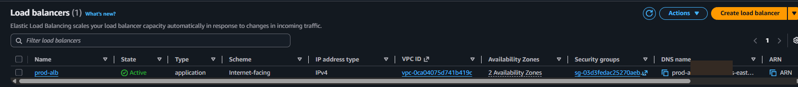

Original Caption:
Figure 1.7 (T8): Internet-facing Application Load Balancer prod-alb Active across 2 AZs (DNS: prod-alb-[REDACTED].us-east-1.elb.amazonaws.com) protected by sg-03d3fedac25270aeb (Sg-alb).

## Evidence 08
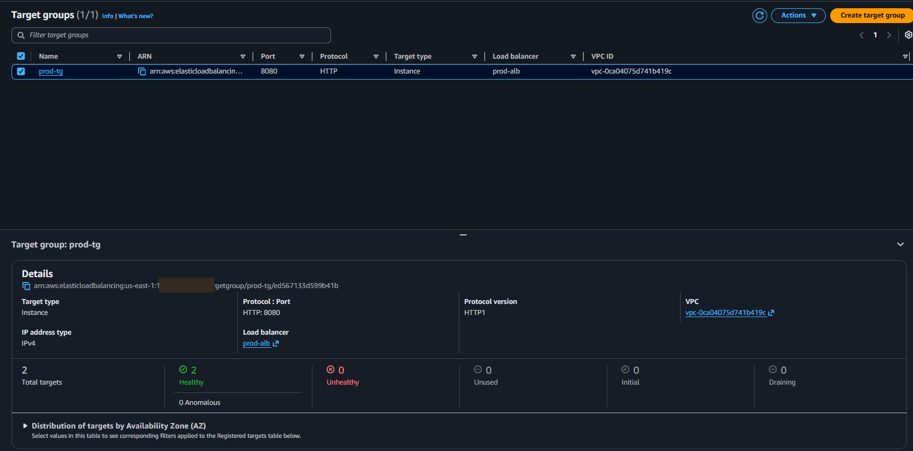

Original Caption:
Figure 1.8 (T8): Target Group prod-tg (HTTP:8080) showing 2 Total Targets — 2 Healthy, 0 Unhealthy across us-east-1a and us-east-1b.

## Evidence 09
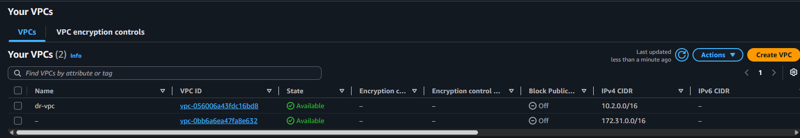

Original Caption:
Figure 1.9 (T12): Pilot Light Disaster Recovery VPC Skeleton dr-vpc (vpc-056006a43fdc16bd8, CIDR 10.2.0.0/16) Available in us-west-2 (Oregon).

## Evidence 10
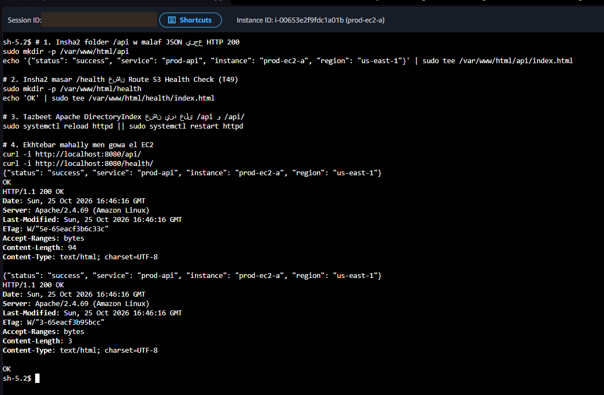

Original Caption:
Figure 1.10a: SSM Session on prod-ec2-a (i-00653e2f9fdc1a01b) configuring & verifying /api/ and /health/ (HTTP/1.1 200 OK).

## Evidence 11
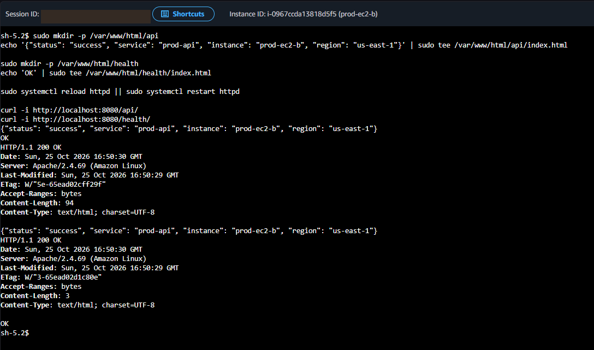

Original Caption:
Figure 1.10b: SSM Session on prod-ec2-b (i-0967ccda13818d5f5) configuring & verifying /api/ and /health/ (HTTP/1.1 200 OK).

## Evidence 12
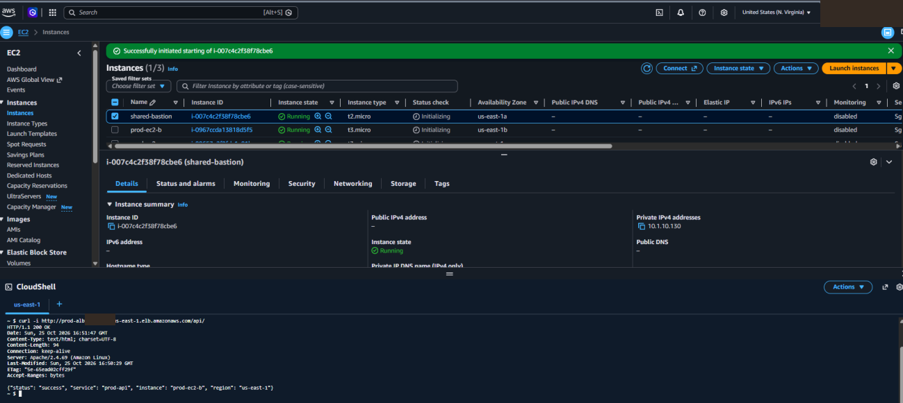

Original Caption:
Figure 1.11: End-to-End Verification from AWS CloudShell — curl -i http://prod-alb-[REDACTED].us-east-1.elb.amazonaws.com/api/ returning HTTP/1.1 200 OK and JSON {"status": "success", "service": "prod-api", "instance": "prod-ec2-b", "region": "us-east-1"}.
