# Security and Segmentation

## Evidence 01
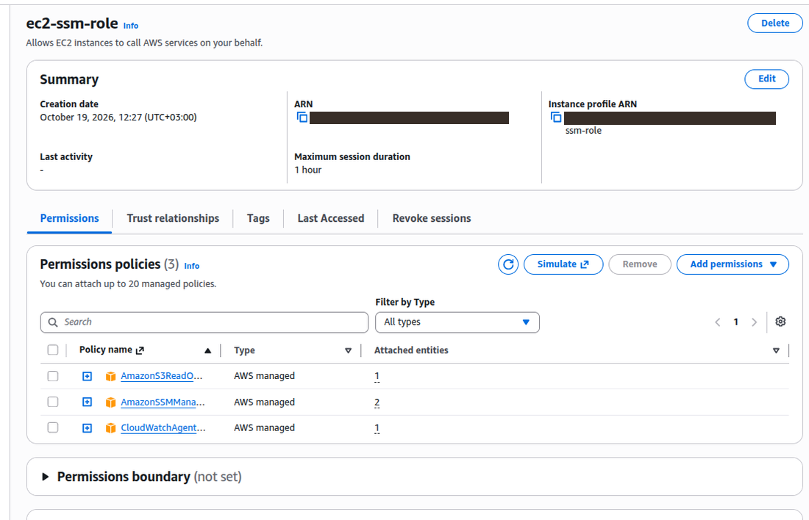

Original Caption:
Figure 1. ec2-ssm-role summary: three managed policies attached.

## Evidence 02
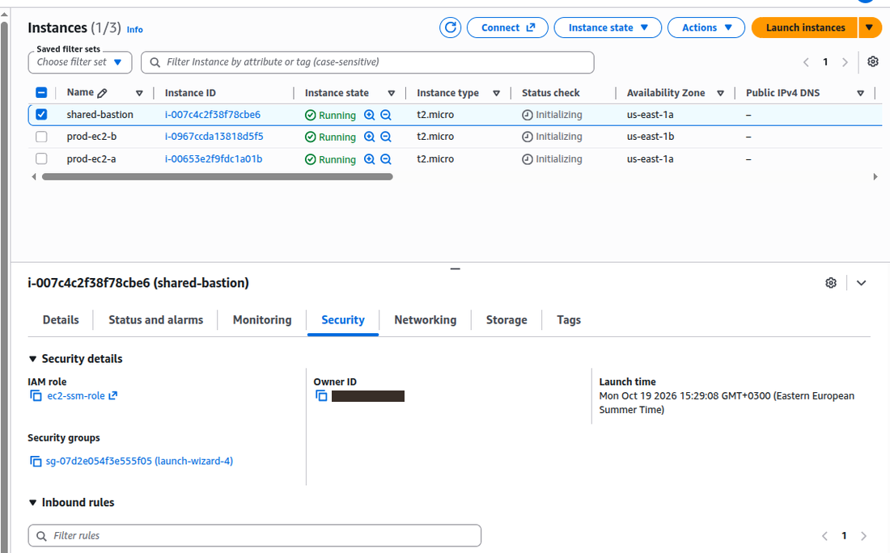

Original Caption:
Figure 2. shared-bastion, Security tab: IAM role ec2-ssm-role (still on its original launch-wizard-4 SG at this point).

## Evidence 03

Original Caption:
Figure 3. prod-ec2-b, Security tab: IAM role ec2-ssm-role.

## Evidence 04

Original Caption:
Figure 4. prod-ec2-a, Security tab: IAM role ec2-ssm-role.

## Evidence 05
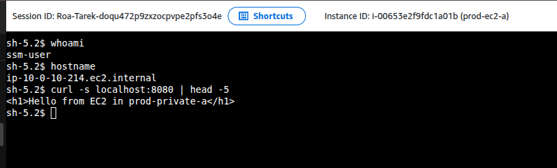

Original Caption:
Figure 5. Session Manager shell on prod-ec2-a: whoami, hostname and curl localhost:8080.

## Evidence 06
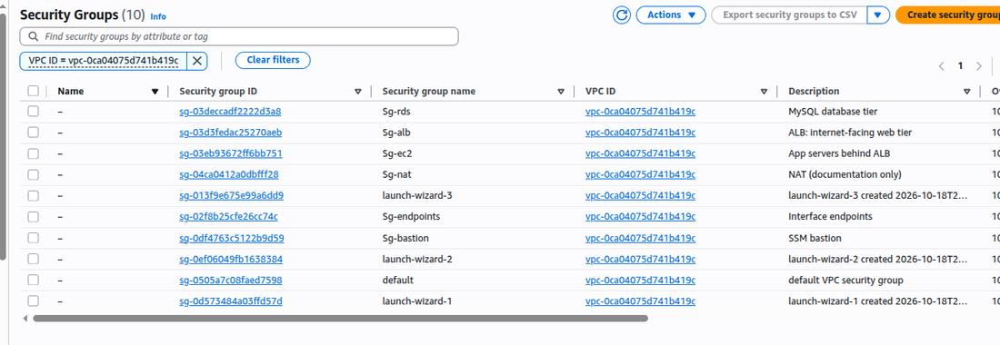

Original Caption:
Figure 6. Security groups in prod-vpc: six new groups with descriptions.

## Evidence 07
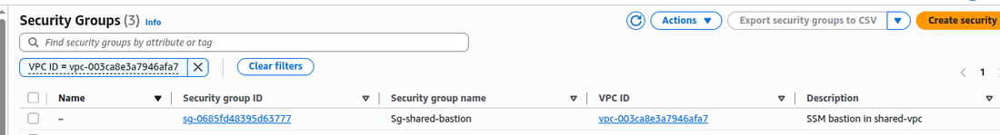

Original Caption:
Figure 7. Security groups in shared-vpc: Sg-shared-bastion.

## Evidence 08
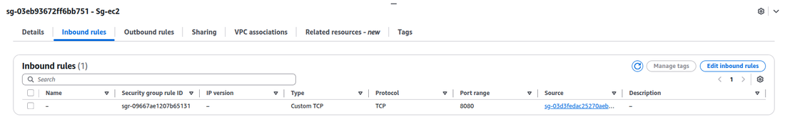

Original Caption:
Figure 8. Sg-ec2 inbound: TCP 8080 from Sg-alb.

## Evidence 09
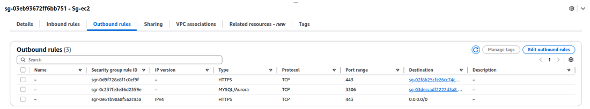

Original Caption:
Figure 9. Sg-ec2 outbound: 443 to Sg-endpoints, 3306 to Sg-rds, 443 to 0.0.0.0/0.

## Evidence 10
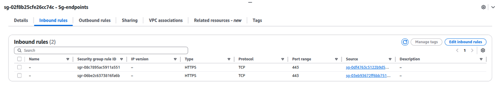

Original Caption:
Figure 10. Sg-endpoints inbound: TCP 443 from Sg-bastion and Sg-ec2.

## Evidence 11
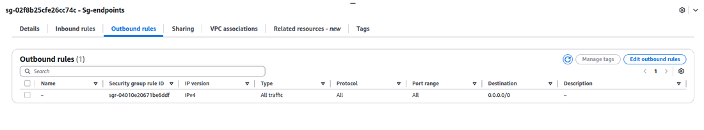

Original Caption:
Figure 11. Sg-endpoints outbound: default all traffic kept.

## Evidence 12
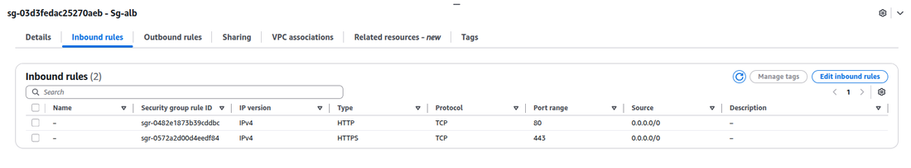

Original Caption:
Figure 12. Sg-alb inbound: TCP 80 and 443 from 0.0.0.0/0.

## Evidence 13
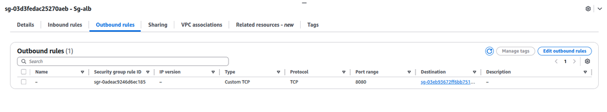

Original Caption:
Figure 13. Sg-alb outbound: TCP 8080 to Sg-ec2.

## Evidence 14
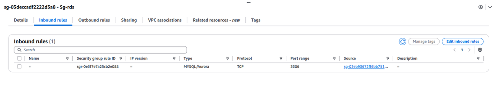

Original Caption:
Figure 14. Sg-rds inbound: TCP 3306 from Sg-ec2.

## Evidence 15
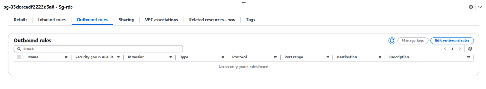

Original Caption:
Figure 15. Sg-rds outbound: no rules.

## Evidence 16
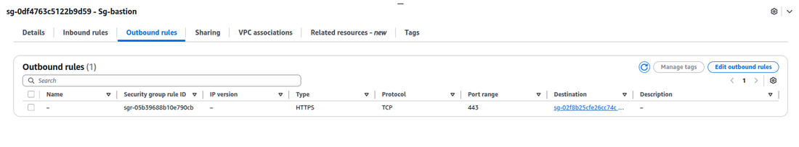

Original Caption:
Figure 16. Sg-bastion outbound: TCP 443 to Sg-endpoints.

## Evidence 17
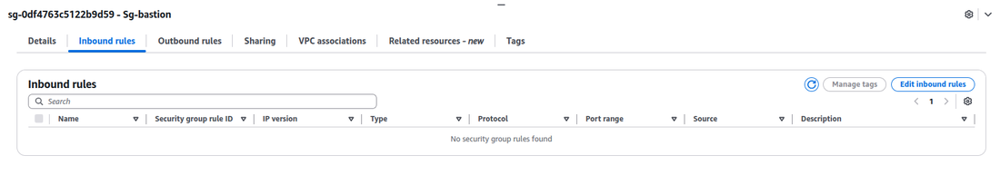

Original Caption:
Figure 17. Sg-bastion inbound: no rules.

## Evidence 18
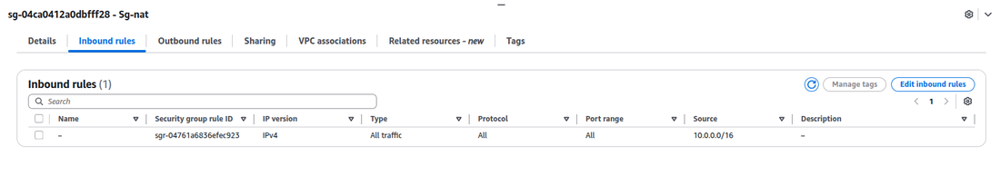

Original Caption:
Figure 18. Sg-nat inbound: all traffic from 10.0.0.0/16.

## Evidence 19
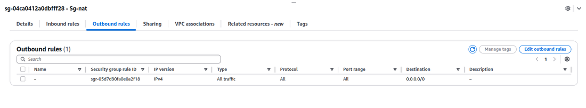

Original Caption:
Figure 19. Sg-nat outbound: all traffic to 0.0.0.0/0.

## Evidence 20
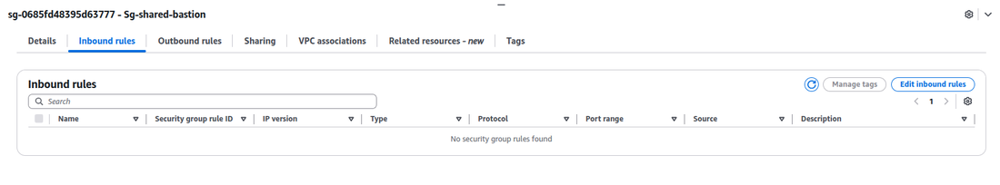

Original Caption:
Figure 20. Sg-shared-bastion inbound: no rules.

## Evidence 21
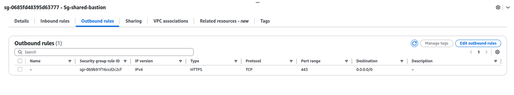

Original Caption:
Figure 21. Sg-shared-bastion outbound: TCP 443 to 0.0.0.0/0.

## Evidence 22
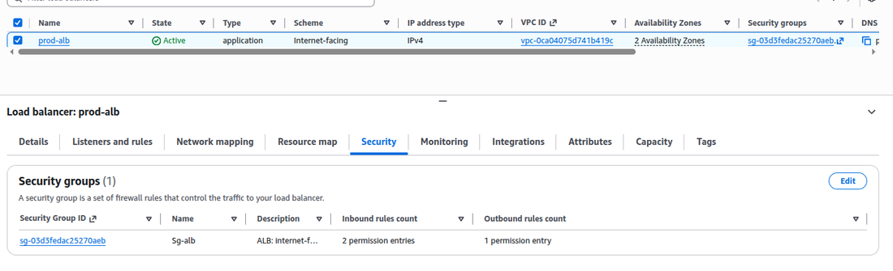

Original Caption:
Figure 22. prod-alb (Active, internet-facing, 2 AZs): Security tab shows Sg-alb.

## Evidence 23
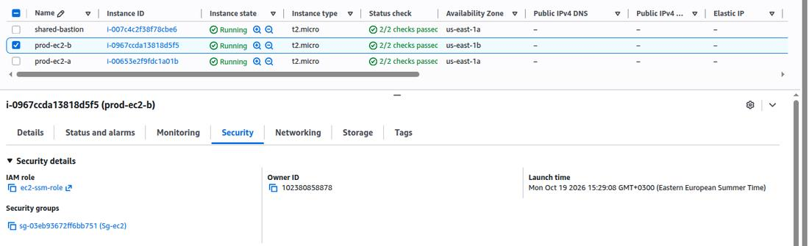

Original Caption:
Figure 23. prod-ec2-b, Security tab: Sg-ec2, status checks 2/2.

## Evidence 24
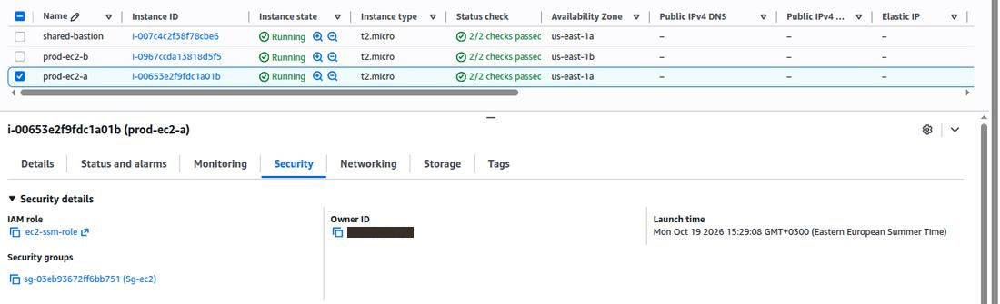

Original Caption:
Figure 24. prod-ec2-a, Security tab: Sg-ec2, status checks 2/2.

## Evidence 25
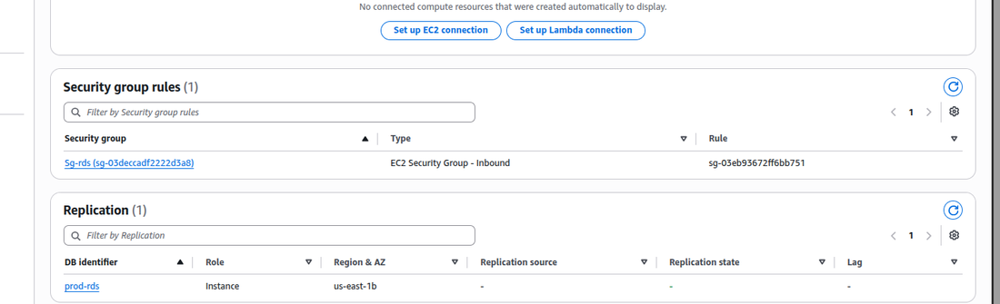

Original Caption:
Figure 25. prod-rds: Sg-rds referenced by an EC2 security group inbound rule; instance in us-east-1b.

## Evidence 26
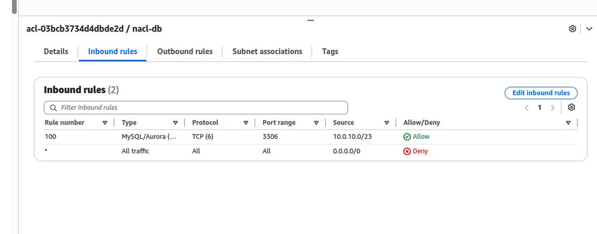

Original Caption:
Figure 27. nacl-db inbound rules.

## Evidence 27
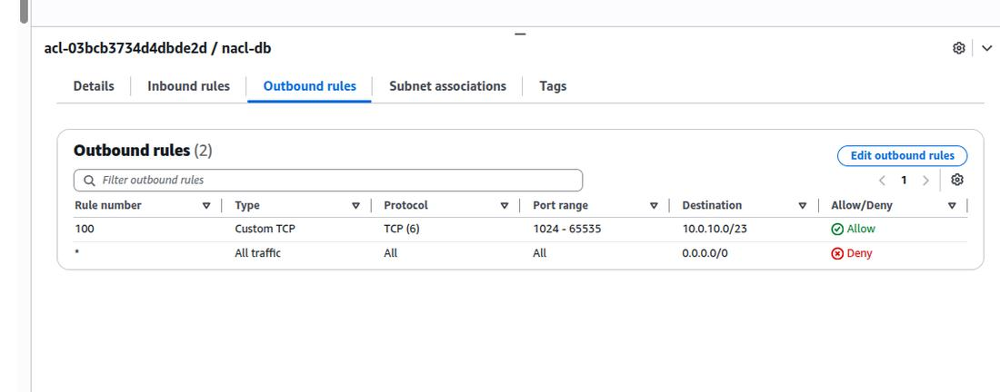

Original Caption:
Figure 28. nacl-db outbound rules.

## Evidence 28
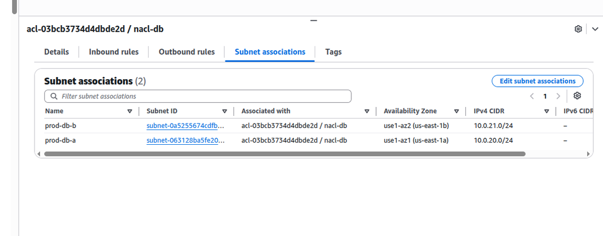

Original Caption:
Figure 29. nacl-db subnet associations: prod-db-a and prod-db-b.

## Evidence 29

Original Caption:
Figure 30. nacl-private inbound rules.

## Evidence 30

Original Caption:
Figure 31. nacl-private outbound rules.

## Evidence 31

Original Caption:
Figure 32. nacl-private subnet associations: prod-private-a and prod-private-b.

## Evidence 32

Original Caption:
Figure 33. nacl-public inbound rules.

## Evidence 33

Original Caption:
Figure 34. nacl-public outbound rules.

## Evidence 34

Original Caption:
Figure 35. nacl-public subnet associations: prod-public-a and prod-public-b.

## Evidence 35

Original Caption:
Figure 26. Target group prod-tg (HTTP 8080): 2 targets, 2 healthy, 0 unhealthy.

## Evidence 36

Original Caption:
Figure 36. Test 1: Reachability Analyzer, Internet gateway to prod-ec2-a: Not reachable.

## Evidence 37

Original Caption:
Figure 37. prod-ec2-a details: no public IPv4 address, private IP 10.0.10.214, subnet prod-private-a.

## Evidence 38

Original Caption:
Figure 39. Test 2: ALB network interface to prod-ec2-a: Reachable.

## Evidence 39

Original Caption:
Figure 40. Test 3: ALB network interface to prod-ec2-a: Not reachable (no ALB egress rule applies).

## Evidence 40

Original Caption:
Figure 41. Test 4: prod-ec2-a to the RDS endpoint on 3306: OPEN.

## Evidence 41

Original Caption:
Figure 42. Test 5: shared-bastion to the RDS network interface: Not reachable (VPCs not connected).

## Evidence 42

Original Caption:
Figure 43. Test 6: curl https://aws.amazon.com from prod-ec2-a returns HTTP/2 200.

## Evidence 43

Original Caption:
Figure 44. rt-db route table: only 10.0.0.0/16 local.

## Evidence 44

Original Caption:
Figure 45. rt-public route table: 0.0.0.0/0 to the internet gateway and the local route.

## Evidence 45

Original Caption:
Figure 46. Test 7: RDS network interface to the internet gateway: Not reachable.

## Evidence 46

Original Caption:
Figure 47. Test 8: Session Manager shell on prod-ec2-a (hostname).

## Evidence 47

Original Caption:
Figure 48. Session Manager launch page for prod-ec2-a.

## Evidence 48

Original Caption:
Figure 49. Reachability Analyzer paths list (5 paths).

## Evidence 49

Original Caption:
Figure 59. prod-ssm-endpoint (7 endpoints, all Available): Security Groups tab shows Sg-endpoints.

## Evidence 50

Original Caption:
Figure 60. prod-ssmmessages-endpoint: Security Groups tab shows Sg-endpoints.

## Evidence 51

Original Caption:
Figure 61. prod-ec2messages-endpoint: Security Groups tab shows Sg-endpoints.

## Evidence 52

Original Caption:
Figure 62. prod-logs-endpoint: Security Groups tab shows Sg-endpoints.

## Evidence 53

Original Caption:
Figure 63. prod-kms-endpoint: Security Groups tab shows Sg-endpoints.

## Evidence 54

Original Caption:
Figure 64. prod-secretsmanager-endpoint (service secretsmanager-fips): Security Groups tab shows Sg-endpoints.

## Evidence 55

Original Caption:
Figure 65. Sg-endpoints inbound rules: TCP 443 from two security groups.

## Evidence 56

Original Caption:
Figure 66. Sg-ec2 inbound rules: three rules, Source column cut off.

## Evidence 57

Original Caption:
Figure 67. nacl-private inbound rules: rule 130, TCP 8080 from 10.1.0.0/16 added.

## Evidence 58

Original Caption:
Figure 68. nacl-private outbound rules: rule 130, TCP 1024-65535 to 10.1.0.0/16 added.

## Evidence 59

Original Caption:
Figure 69. Session Manager shell on prod-ec2-a after the rule changes (whoami, hostname).

## Evidence 60

Original Caption:
Figure 50. project-trail details: Logging, multi-region Yes, log file validation Enabled.

## Evidence 61

Original Caption:
Figure 51. S3 bucket path for 19 October 2026 containing a CloudTrail log file.

## Evidence 62

Original Caption:
Figure 52. Event history filtered on CreateRole.

## Evidence 63

Original Caption:
Figure 53. GuardDuty findings list with one sample finding open.

## Evidence 64

Original Caption:
Figure 54. GuardDuty summary: 479 total findings, severity breakdown.

## Evidence 65

Original Caption:
Figure 55. Security Hub enabled confirmation.

## Evidence 66

Original Caption:
Figure 56. Security Hub summary: Threat summary with sample findings.

## Evidence 67

Original Caption:
Figure 57. Security Hub Threats page filtered to Critical, with a finding open.

## Evidence 68

Original Caption:
Figure 58. Security standards widget: two standards enabled, security score still generating.

## Evidence 69

Original Caption:
Figure 70. Sg-ec2 inbound rules: six rules, with sources visible.

## Evidence 70

Original Caption:
Figure 71. Load balancers: prod-nlb (network, internal, Active) and prod-alb.

## Evidence 71

Original Caption:
Figure 72. Target group tg-privatelink (TCP 8080): prod-ec2-a and prod-ec2-b Healthy.

## Evidence 72

Original Caption:
Figure 73. Endpoint service prod-privatelink-service: Available, acceptance required, prod-nlb attached.

## Evidence 73

Original Caption:
Figure 74. Endpoints list: shared-privatelink-endpoint, Pending acceptance.

## Evidence 74

Original Caption:
Figure 75. Endpoint service, Endpoint connections tab: Pending acceptance.

## Evidence 75

Original Caption:
Figure 76. Endpoint service, Endpoint connections tab: connection Available.

## Evidence 76

Original Caption:
Figure 77. shared-privatelink-endpoint: Available, shared-vpc, subnet shared-private-a, IP 10.1.10.45, DNS names.

## Evidence 77

Original Caption:
Figure 78. prod-nlb attributes: cross-zone load balancing enabled.

## Evidence 78

Original Caption:
Figure 79. tg-privatelink, Targets tab: both targets Healthy.

## Evidence 79

Original Caption:
Figure 80. Sg-shared-bastion outbound rules with the 8088 typo.

## Evidence 80

Original Caption:
Figure 81. Sg-shared-endpoint inbound: TCP 8080 from Sg-shared-bastion.

## Evidence 81

Original Caption:
Figure 82. Sg-shared-bastion outbound rules after the fix: 8080 to 10.0.0.0/16 and 10.1.0.0/16.

## Evidence 82

Original Caption:
Figure 83. Endpoints list (11): shared SSM endpoints and shared-privatelink-endpoint-2, all Available.

## Evidence 83

Original Caption:
Figure 84. shared-privatelink-endpoint-2, Security Groups tab: Sg-shared-endpoint.

## Evidence 84

Original Caption:
Figure 85. nacl-private subnet associations: prod-private-a and prod-private-b.

## Evidence 85

Original Caption:
Figure 86. nacl-private inbound rules: 8080 from 10.1.0.0/16 (130) and 10.100.0.0/22 (140).

## Evidence 86

Original Caption:
Figure 87. nacl-private outbound rules: 1024-65535 to 10.1.0.0/16 (130) and 10.100.0.0/22 (140).

## Evidence 87

Original Caption:
Figure 88. shared-vpc default NACL inbound rules: allow all.

## Evidence 88

Original Caption:
Figure 89. shared-vpc default NACL outbound rules: allow all.

## Evidence 89

Original Caption:
Figure 90. Test 23: shared-bastion session, TCP check OPEN and curl through the endpoint DNS name returns HTTP 200.

## Evidence 90

Original Caption:
Figure 91. prod-nlb Security tab: Sg-nlb attached, Enforce inbound rules on PrivateLink traffic On.
