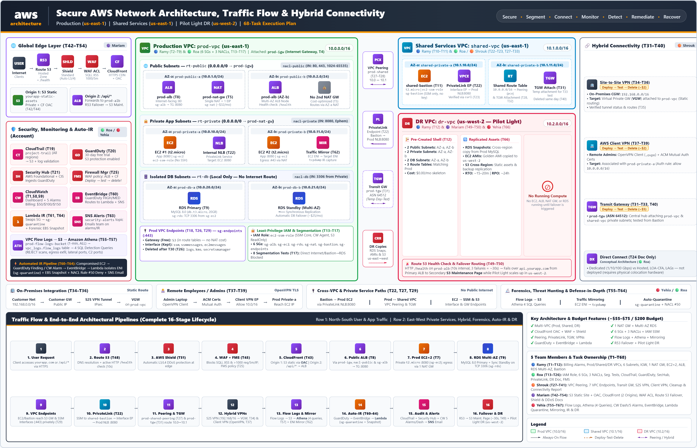

# Secure AWS Network Architecture, Traffic Flow & Hybrid Connectivity

> **DEPI Graduation Project** — a multi-tier AWS network architecture built around segmentation, private connectivity, edge security, monitoring, incident response, disaster recovery planning, and cost-aware teardown.

**Core principle:** Secure → Segment → Connect → Monitor → Detect → Remediate → Recover

## Project overview

This team project designed, implemented, tested, and documented a defense-in-depth AWS network for a production-style web workload. The documented lab architecture spans a production VPC and shared-services VPC in `us-east-1`, a pilot-light disaster-recovery VPC in `us-west-2`, and a simulated on-premises network.

The design brings together:
- Multi-tier VPC and subnet segmentation for public entry, private application servers, and isolated database resources.
- Application Load Balancing and a Multi-AZ Amazon RDS database during the lab deployment.
- Least-privilege Security Groups and stateless Network ACLs, with connectivity checks.
- VPC Peering, VPC Endpoints, AWS PrivateLink, Transit Gateway, Site-to-Site VPN, and Client VPN demonstrations.
- Amazon S3 private static hosting through CloudFront Origin Access Control (OAC), AWS WAF, Route 53 failover planning, and AWS Shield Standard.
- VPC Flow Logs, Amazon Athena threat-hunting queries, CloudWatch dashboards and alarms, GuardDuty, Security Hub, CloudTrail, and an EventBridge-to-Lambda quarantine workflow.
- A pilot-light disaster-recovery design and a dependency-ordered teardown to limit ongoing lab costs.

**Important lifecycle note:** The final report states that the lab resources were torn down after testing. This repository documents the architecture and evidence; it does not claim that the AWS environment is still deployed or publicly reachable.

## Architecture at a glance



## Team contributions

The project was delivered by five team members. The detailed responsibility matrix is in [`Project_Documents/team-contributions.md`](Project_Documents/team-contributions.md).

| Team member | Primary workstream |
|---|---|
| Ramy Ahmed (Lead) | VPC foundation, compute and database networking, load balancing, DR network skeleton, backend health/API path fix |
| Roa | IAM, Security Groups, Network ACLs, segmentation tests, CloudTrail, GuardDuty, Security Hub, PrivateLink support, Direct Connect concepts |
| Shrouk | VPC Peering, VPC Endpoints, Transit Gateway, Site-to-Site VPN, Client VPN verification and connectivity cleanup |
| Mariam | Private S3 delivery, CloudFront OAC, API/health routing, AWS WAF, Route 53 failover, edge-security documentation |
| Yehia | Flow Logs, Athena threat hunting, CloudWatch monitoring, alerts, EventBridge/Lambda response, traffic mirroring, IR runbook, DR plan |

Final cleanup was documented as a shared team activity. See the detailed contributions page for scope boundaries and documented exceptions.

## Key outcomes documented in the report

- Established a segmented, multi-VPC, multi-tier AWS design.
- Verified application targets and backend API/health routes during the lab.
- Ran eight documented segmentation checks for the security workstream.
- Demonstrated VPC Peering, endpoint-based private access, and PrivateLink connectivity.
- Tested Client VPN connectivity successfully in the rebuilt lab run; the Site-to-Site VPN was configured for a simulated customer gateway and its tunnels were down by design.
- Implemented and documented network telemetry, threat queries, alarms, and an automated quarantine workflow.
- Documented disaster-recovery planning and a dependency-ordered teardown after verification.

For test details and caveats, see [`Project_Documents/testing-and-validation.md`](Project_Documents/testing-and-validation.md) and [`Project_Documents/limitations-and-lessons-learned.md`](Project_Documents/limitations-and-lessons-learned.md).

## Repository map

```text
Project_Diagram/    Sanitized architecture diagram
Project_Documents/  Architecture, team ownership, security, connectivity, monitoring, testing, DR and cost notes
Evidence/           Five evidence sections containing sanitized screenshots and test results
```

## Security and publication notice

This repository is intended for **public, sanitized project documentation**. Do not commit:
- AWS access keys, secret keys, session tokens, passwords, private keys, VPN profiles containing private keys, or unredacted certificates.
- Unnecessary account IDs, resource ARNs/IDs, public IPs, endpoints, personal email addresses, or screenshots exposing sensitive values.
- Original lab exports before reviewing them for secrets and identifying information.

The source report must be sanitized before publication. Keep the unmodified report and any sensitive lab artifacts in private storage. If a private key was already published, removing it from a later commit does not make the exposed key safe; assess and revoke/rotate the affected credential or certificate.

## Reproducing the lab

This repository is documentation-first. It does not currently provide a fully reproducible Infrastructure-as-Code deployment. Do not recreate the environment from prose alone without checking current AWS service behavior, permissions, regional availability, and pricing. Several resources in the original lab were intentionally deleted to prevent ongoing charges.

## Suggested learning areas

- AWS VPC, subnetting, routing, NAT, and internet gateways
- Security Groups vs. Network ACLs
- VPC Peering, PrivateLink, Transit Gateway, and VPN connectivity
- CloudFront OAC and AWS WAF
- CloudTrail, VPC Flow Logs, Athena, GuardDuty, and Security Hub
- Event-driven incident response with EventBridge and Lambda
- Cost-aware lab lifecycle management

## Project status

**Completed lab and documentation; deployment resources torn down after validation.** Some planned items were intentionally deferred or documented conceptually rather than deployed. These are called out in the project documentation instead of being presented as completed implementations.
